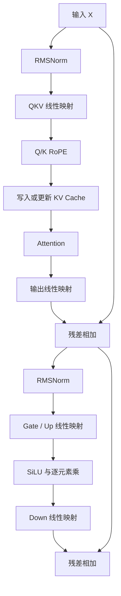

# LLM 算子梳理：从 Decoder 到 FlashInfer

LLM 算子优化首先需要回答：输入输出是什么形状，计算与访存分别有多少，当前瓶颈在哪里。相同的线性层在长 prompt 的 prefill 和单 token 的 decode 中，可能需要完全不同的实现策略。

本文以常见的 pre-norm、RoPE、GQA、SwiGLU Decoder 为例。不同模型可能使用 LayerNorm、QK Norm、MoE 或其他结构，不能把这一条计算路径套到所有模型。

## 1. 先统一维度

| 符号 | 含义 |
|------|------|
| B | 本次参与计算的请求数 |
| T | 本次处理的 token 总数；变长 batch 中为各请求长度之和 |
| D | hidden size |
| Hq / Hkv | Query / KV head 数，GQA 中 Hq 是 Hkv 的整数倍 |
| d | head dimension，通常 D=Hq·d |
| F | FFN intermediate size |
| L | 单个请求可见的 KV 长度 |

张量可以先按 `X[T,D]` 理解。Prefill 的 T 随 prompt 长度增大；普通逐 token decode 中每个活跃请求处理一个新 token，此时 `T=B`。Speculative decoding 和多 token append 需要按真实 query 长度重新分析。

## 2. 一层 Decoder 的计算路径



图中是逻辑算子，实际运行时可能把多个步骤融合，也可能使用打包布局，不能据此推断 kernel 启动次数。

## 3. 线性映射：先写成矩阵乘

把权重约定为 `[out_features,in_features]`：

```text
QKV:  [T,D] × [D,(Hq+2Hkv)d] -> [T,(Hq+2Hkv)d]
O:    [T,Hq·d] × [Hq·d,D]    -> [T,D]
Gate: [T,D] × [D,F]           -> [T,F]
Up:   [T,D] × [D,F]           -> [T,F]
Down: [T,F] × [F,D]           -> [T,D]
```

数学中的右矩阵是存储权重的转置。QKV 或 Gate/Up 可以合成一次较宽的 GEMM，但合并以后仍要确认输出布局、量化 scale 和下游算子能否直接使用。

对 `A[M,K]B[K,N]`，浮点运算量约 `2MNK`。理想情况下，A、B 各读一次、输出写一次，每元素 s 字节时，算术强度估计为：

$$
I\approx\frac{2MNK}{s(MK+KN+MN)}.
$$

这是忽略缓存、重读、scale 和工作区的简化模型。固定 N、K 后减小 M，权重读流量会更加突出；因此 decode 小 batch 的线性层可能受带宽或并行度限制，不能仅凭矩阵很大就认定是算力瓶颈。

## 4. RMSNorm：归约与逐元素操作

每一行 x 的 RMSNorm 为：

$$
y_i=\frac{x_i}{\sqrt{\frac1D\sum_jx_j^2+\epsilon}}w_i.
$$

主要步骤是求平方和、计算倒数平方根、逐元素缩放。FlashInfer 固定版本中的 [RMSNormKernel](https://github.com/flashinfer-ai/flashinfer/blob/592b110a78725e034daf3a3c978053e7dae92e5c/include/flashinfer/norm.cuh) 使用向量化加载、warp 内归约和跨 warp 归约，统计量以 FP32 处理。

需要关注 hidden dimension 的向量化对齐、每行的线程数，以及数据是否需要再次加载。更大的线程块可能缩短归约，也可能减少同一 SM 可同时驻留的块数。

`fused_add_rmsnorm` 把残差相加与归一化放到同一次调用，并更新传入的状态张量。融合示例必须先确认原地修改语义，否则重复执行 benchmark 时可能一直累加 residual，输入已经不再相同。

## 5. RoPE：位置、布局与 KV 写入

RoPE 对一对通道做旋转：

$$
q'_{2i}=q_{2i}\cos\theta-q_{2i+1}\sin\theta,\qquad
q'_{2i+1}=q_{2i}\sin\theta+q_{2i+1}\cos\theta.
$$

不同模型可能采用相邻通道配对或前后半区配对，rotary dimension、频率缩放和 position offset 也可能不同。KV Cache 命中已有前缀时，新 token 的 position 不能从 0 重新开始。

RoPE 通常作用于 Q/K，V 不执行同样的旋转。将 RoPE 与 KV 写入融合可以减少中间结果流量，但仍需保证页面索引、写入位置和布局匹配。源码入口见 [flashinfer/rope.py](https://github.com/flashinfer-ai/flashinfer/blob/592b110a78725e034daf3a3c978053e7dae92e5c/flashinfer/rope.py)。

## 6. Attention：分开看 Prefill 与 Decode

每个 Query head 对对应的 KV head 执行：

$$
O=\operatorname{softmax}\left(\frac{QK^T}{\sqrt d}+\text{mask}\right)V.
$$

Prefill 同时处理多行 Q，有机会复用 K/V，并使用矩阵乘法单元。Decode 中单请求只有一行 Q，长上下文下扫描 KV 的流量往往成为主要成本。

GQA 通过多个 Query head 共享 KV head，降低 KV Cache 容量。能否转化为实际带宽收益，还取决于 kernel 是否复用了同一 KV 数据。参见固定版本的 [single_decode_with_kv_cache](https://github.com/flashinfer-ai/flashinfer/blob/592b110a78725e034daf3a3c978053e7dae92e5c/flashinfer/decode.py) 及 [single_prefill_with_kv_cache](https://github.com/flashinfer-ai/flashinfer/blob/592b110a78725e034daf3a3c978053e7dae92e5c/flashinfer/prefill.py)。

## 7. SwiGLU 与算子融合

常见形式为 `SiLU(XWgate) * (XWup)`，再乘 `Wdown`。SiLU 是 `x*sigmoid(x)`，门控相乘是逐元素操作。

如果把 gate/up 的结果连续打包，激活与相乘可由一个 kernel 完成，减少启动次数和中间写回。FlashInfer 的 [activation.py](https://github.com/flashinfer-ai/flashinfer/blob/592b110a78725e034daf3a3c978053e7dae92e5c/flashinfer/activation.py) 提供 `silu_and_mul` 等入口，使用前要确认末维如何分成两半。

融合也会增加单次 kernel 的寄存器、共享内存或布局约束。只看到启动次数下降，还不能证明端到端变快。

## 8. 量化与 MoE 的额外成本

量化除了把 FP16 权重换成 INT8/FP8/INT4 等表示，还需要考虑 scale 粒度、打包格式、反量化与累加精度。W8A16 和 W8A8 的数据通路不同；存储位宽不等于乘加指令位宽。

MoE 在线性层外还有路由、token 重排、按专家分组与输出归并。Grouped GEMM 能统一调度多组形状不同的矩阵乘，但不包含完整路由过程。衡量 MoE 优化时应把这些阶段分别计时。

## 9. 从 Python API 追到 Kernel

本文固定 FlashInfer `v0.2.5`，commit `592b110a78725e034daf3a3c978053e7dae92e5c`。建议按以下路径阅读：

| 层次 | 入口 | 要确认的内容 |
|------|------|--------------|
| Python | `flashinfer/gemm.py`、`decode.py`、`prefill.py` | shape、dtype、layout、mask、backend |
| 绑定与生成 | `csrc/`、`flashinfer/jit/` | 模板参数、编译选项、workspace、launch |
| 设备实现 | `include/flashinfer/gemm/`、`attention/` | 分块、加载、归约、写回 |
| 验证 | PyTorch 参考实现与配套示例 | 相同语义、误差、计时范围 |

例如 `SegmentGEMMWrapper.run` 会先准备每个 segment 的指针、维度和 stride，再选择 SM80/SM90 路径；不应把 Python wrapper 本身当作 GEMM 主循环。

## 10. 如何安排优化实验

先记录 GPU、驱动、CUDA、库版本、输入 shape、dtype、stride 和 backend。分别测长短 prompt、不同 batch 的 decode，以及真实 KV 长度分布。

先与 FP32 参考检查正确性，再进行预热和重复计时。首次调用可能包含 JIT 编译；CUDA 异步执行需要使用 CUDA Event 或明确同步。`plan`、`run`、数据重排和分配成本应按测量目标分别报告。

只有算子耗时与端到端耗时同时记录，才能判断优化是否改善首 token 延迟或逐 token 延迟。本文给出分析与复现入口，不把估算流量写成实测带宽。
